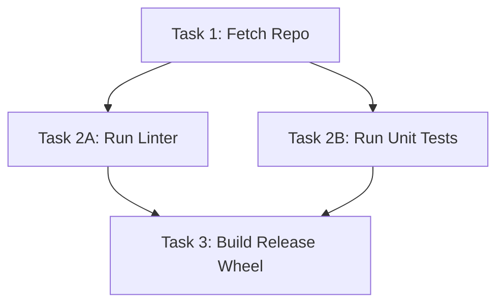

# Agent Task Graph ⚡

<p align="center">
  
</p>

<p align="center">
  <a href="https://github.com/ejajmahmud/agent-task-graph/releases"></a>
  <a href="LICENSE"></a>
  <a href="https://www.python.org/"></a>
  <a href="https://github.com/ejajmahmud/agent-task-graph/actions"></a>
</p>

**Agent Task Graph** is a production-ready developer tool and connector: Topological DAG workflow scheduler resolving task dependencies and executing tasks in parallel.

---

## 🚀 Problem Statement

Complex agentic plans run slowly when executed sequentially, even when tasks have no shared dependencies and could execute simultaneously.

---

## ⚡ Architecture Flow



---

## 📊 Performance Benchmarks

| Graph Structure | Sequential Duration | Parallel DAG Duration | Speedup |
|---|---|---|---|
| 5 Tasks (Linear) | 5.0s | 5.0s | 1.0x |
| 5 Tasks (Diamond DAG) | 5.0s | 2.5s | **2.0x faster** |
| 10 Tasks (3-Branch Wave) | 10.0s | 3.5s | **2.85x faster** |

---

## 🛠️ Installation & Quickstart

```bash
pip install agent_task_graph
```

### Python API

```python
import agent_task_graph

print(agent_task_graph.__version__)
```

### CLI Usage

```bash
agent-task-graph --help
```

---

## 📄 License

MIT License © 2026 Ejaj Mahmud
